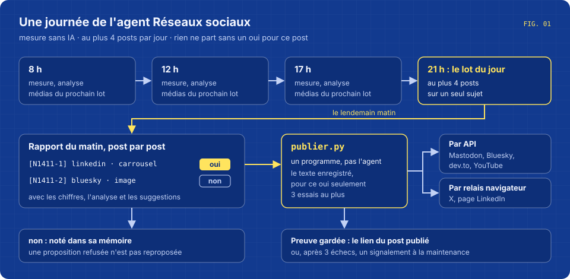
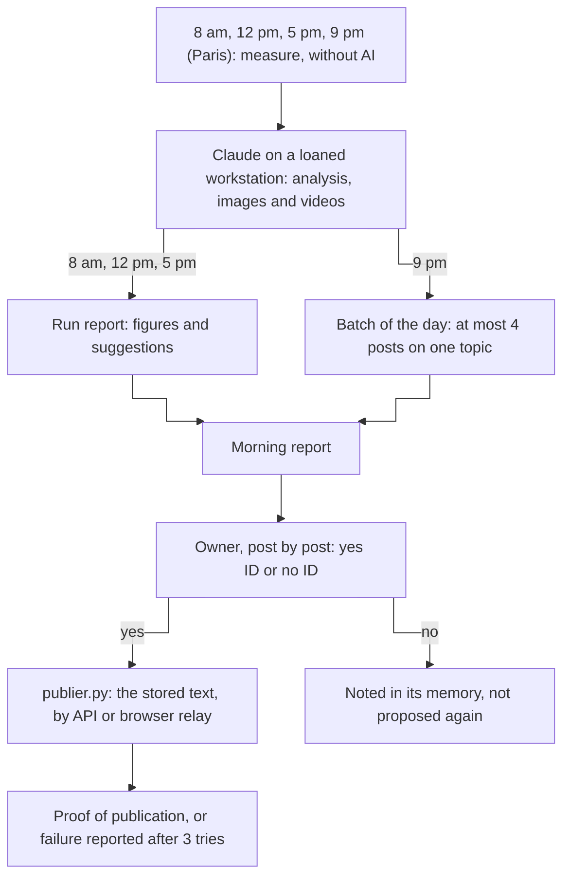
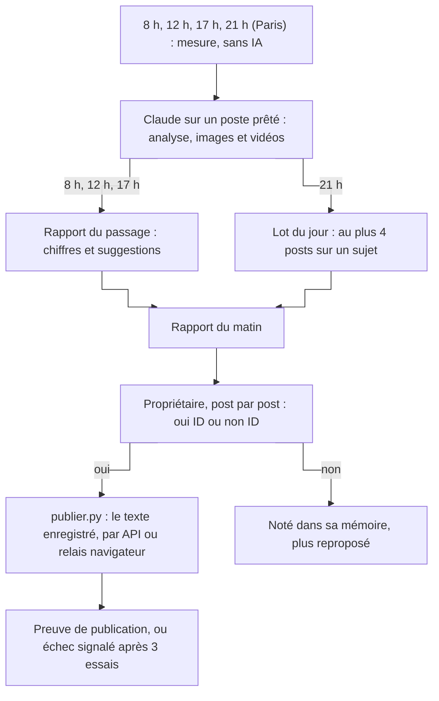

# Agent - Social media

Four times a day, it measures the audience of the Ingevision accounts and prepares posts; a post goes out only after a person has said yes to that exact post.





**English** · [Français](#version-française)

## What it does

- **Measures before each run, without AI.** `mesurer.py` reads the followers on Mastodon, Bluesky, dev.to and YouTube, and the site visits that came from the networks over the last 8 days (from the web server log, by `utm_source` or by referring site). X and the LinkedIn page have no free API: the agent reads their public pages itself during the run and writes `null` if the page refuses.
- **Four runs a day: 8 am, 12 pm, 5 pm and 9 pm, Paris time.** Each run compares the figures with the previous ones, says what worked and what did not, and moves the images, carousels and short videos of the next batch forward. Media are made on the workstation, in a headless browser, in blue, yellow and white.
- **The evening run hands in the batch of the day**: at most four proposals on a single topic, each with its exact text, its media, its tracked link, why it should help and the figure that will tell if it worked. On Saturday evening the run lasts up to 3 hours, for the reel of the week and, once a month, the YouTube video.
- **Everything goes into the morning report.** The owner answers post by post, `oui N1411-2` or `non N1411-2`. A refusal goes into the agent's memory so it does not come back.
- **A program publishes, not the agent.** For each yes not yet sent, `publier.py` takes the text stored in the report and posts it: through the API for Mastodon, Bluesky, dev.to and YouTube; through a browser relay on another machine for X and the LinkedIn page, which is asked to post the text without changing a character and to return the link. The proof is kept in `envoyes/<ID>.json`. After three failures, the program reports the post to maintenance.
- **Effort is counted, not declared.** `compter-effort.py` reads the session of the run: tools really used, pages of the site opened, web searches, repositories cited. Below the floor set in `effort.json`, the agent is sent back once to finish what is missing.


It is meant for a consultant who wants a regular presence on the networks, built on real work, without giving an agent the keys to publish.

## The morning report

```
Passages du 14/11 : 8 h, 12 h, 17 h, 21 h (sur 4 prévus).

Abonnés : mastodon 41, bluesky 58, devto 12, youtube 9, x ?, linkedin ?
Visites du site venues des réseaux (7 jours) : 37

— Passage de 21 h : audience stable sur la semaine ; lot du jour sur la fusion de branches du samedi.
  • Carrousel de mardi : 6 clics vers le site depuis LinkedIn, aucun depuis X.
  • Suggestion : publier le carrousel le matin, les clics de mardi sont tous arrivés avant 10 h.

À VALIDER, post par post (2) — en session : « oui N…-n » ou « non N…-n » ; publié seulement après ton oui, texte inchangé :

[N1411-1] linkedin · carrousel · Fusionner un peu chaque samedi
Chaque samedi soir, un agent essaie de fusionner toutes les branches d'un projet. […]
Médias : …/medias/2026-11-14/fusion-carrousel.pdf
Pourquoi : montrer un agent qui travaille seul — Mesure : clics vers la fiche sous 7 jours

[N1411-2] bluesky · image · Fusionner un peu chaque samedi
[…]
```
*(fictional example; the report is written in French)*

## What it never does

- Publish a post itself. Publishing belongs to `publier.py`, after a yes for that post.
- Like, comment, reply, follow or send a private message without a yes; visit profiles automatically.
- Touch the owner's personal LinkedIn profile, use Reddit, pay or sponsor anything, log in to an account, write a secret in a file.
- Change a text after the yes: a changed text is a new proposal.
- Name a client: the names to keep quiet are in a local file, outside the repository.

**What the code holds, and what only the instructions hold.** The code holds the yes: `publier.py` only sends a proposal whose validation says `oui`, only once, and sends the text stored in the report. The agent has no access to the server at all: it works in a copy on a borrowed workstation, receives what it needs to read in `sources/` (read-only copies), and its media come back on their own after the run. It therefore cannot reach `publier.py` or the keys. A hook (`garde/garde-arret.py`) also refuses any stopping of programs by name. Everything else in this list (no likes, no comments, no personal profile, no Reddit, at most four posts) holds by the instructions. For X and the LinkedIn page, "the exact text" is asked of the relay, which is itself an agent driving a browser; no program compares the result.

## Requirements

Taken from `lancer.sh`, `mesurer.py`, `publier.py` and `deposer.py`:

- A Linux server with `bash`, `cron`, `flock`, `rsync`, `perl`, `python3`, GNU `date`, `ssh` and `scp`. It runs the measures, the runs and the publishing.
- A launcher that starts a Claude Code agent on a loaned workstation and returns code 75 when none is free, an account selector and the token files it reads. The runs wait in the same queue as other agents (`/tmp/agents-site.lock`).
- The workstation: [Claude Code](https://code.claude.com/docs/en/overview), Node.js and npm (Playwright 1.60.0 is installed at each run), and Python for the hook. No access back to the server is needed.
- The site's web server log, read with `docker logs` over SSH (target in `VPS_ROOT` or `~/.config/agents/vps-root`).
- API keys in `~/.config/secrets/ingevision/`: `mastodon.key`, `bluesky.key`, `devto.key`, `youtube.key`. They are read by the programs and never shown.
- For X and the LinkedIn page: a relay script that drives a browser already logged in, on a machine reachable as SSH host `tour`.
- Outside this repository: the tool that builds the morning report, the maintenance signal, and the step that records the owner's answer in `validations/<ID>.json`.

The paths under `/home/claude` and the account names (Mastodon, Bluesky, X, LinkedIn page) are written in the scripts. On another installation, change them.

## Install

```bash
git clone https://github.com/anthohunt/agent-reseaux-sociaux
cd agent-reseaux-sociaux
cat > reglages.local <<'EOF'
ALLUMER_TOUR=/chemin/vers/allumer-relais          # wakes the relay machine if it is off
LINKEDIN_ADMIN=https://www.linkedin.com/company/<id>/admin/
EOF
cat > anonymiser.local.md <<'EOF'
## Noms à ne jamais écrire
- Client A
EOF
mkdir -p ~/.config/agents && echo "utilisateur@serveur-web" > ~/.config/agents/vps-root
python3 mesurer.py                       # first measure: mesures/<date>.json
python3 publier.py --essai               # what would be published, without publishing
# crontab: lancer.sh checks Paris time itself and does nothing outside its window
# 0,30 * * * * /chemin/lancer.sh matin
# 0,30 * * * * /chemin/lancer.sh midi
# 0,30 * * * * /chemin/lancer.sh apresmidi
# 0,30 * * * * /chemin/lancer.sh soir
# */10 * * * * flock -n /tmp/publier.lock python3 /chemin/publier.py
```

A run is retried every half hour for two hours if no workstation is free; a marker in `logs/` stops it from running twice the same day. The evening run never starts after 11 pm. `FORCE=1` runs outside the time window; `ESSAI=1` runs a short trial with a small model, and nothing comes back from it. `deposer.py <date> --apercu` prints the part of the morning report without sending it. `flock` in the last line keeps two publishing rounds from overlapping, since the relay can take up to 30 minutes.

`lancer.sh` creates `logs/`, `rapports/`, `validations/`, `envoyes/`, `medias/`, `w/` and `verrous/`; `mesurer.py` creates `mesures/`. All of them stay out of git.

## Files

| File | Role |
|---|---|
| `lancer.sh` | One run: measures, copies the working files to the workstation, starts the agent (80 min, 3 h on Saturday evening), counts its effort and sends it back once if needed, brings back the report, memory and media, wipes the copy. |
| `consigne.md` | How the agent works: what each run does, the publishing rules, the report it hands in. |
| `consigne-contenu.md` | What to produce: the goal, the editorial line, the tone, the formats per network, how media are made. |
| `consigne-reprise.md` | The instruction given when the effort was below the floor. |
| `effort.json` | The effort floor of each run. |
| `mesurer.py` | Followers per network and visits from the networks, without AI. |
| `publier.py` | Publishes the posts that got a yes, keeps the proof, reports failures. |
| `deposer.py` | Writes the social media part of the morning report. |
| `renumeroter.py` | Gives each proposal an ID that is never used twice on the same day. |
| `compter-effort.py` | Reads the session of a run and counts the effort. |
| `garde/` | The hook installed on the workstation (`settings.json`, `garde-arret.py`). |
| `reglages.local`, `anonymiser.local.md` | The settings of the installation and the names to keep quiet, outside the repository. |

The instructions and comments are in French. It is one of the permanent agents that run on their own every day in a small system of Claude Code agents.

## Its page

[Its page on ingevision.cloud](https://ingevision.cloud/en/ai-agents/?p=agent-reseaux-sociaux) presents what it does, in English and French.

---

## Version française

# Agent - Réseaux sociaux

Quatre fois par jour, il mesure l'audience des comptes Ingevision et prépare des posts ; un post ne part qu'après le oui d'une personne pour ce post précis.




### Ce qu'il fait

- **Mesure avant chaque passage, sans IA.** `mesurer.py` relève les abonnés sur Mastodon, Bluesky, dev.to et YouTube, et les visites du site venues des réseaux sur les 8 derniers jours (dans le journal du serveur web, par `utm_source` ou par site d'origine). X et la page LinkedIn n'ont pas d'API gratuite : l'agent lit lui-même leurs pages publiques pendant le passage et note `null` si la page refuse.
- **Quatre passages par jour : 8 h, 12 h, 17 h et 21 h, heure de Paris.** Chaque passage compare les chiffres aux précédents, dit ce qui a marché et ce qui n'a pas marché, et avance les images, carrousels et vidéos courtes du prochain lot. Les médias sont fabriqués sur le poste, dans un navigateur sans écran, en bleu, jaune et blanc.
- **Le passage du soir rend le lot du jour** : au plus quatre propositions sur un seul sujet, chacune avec son texte exact, ses médias, son lien suivi, ce qu'elle doit faire monter et le chiffre qui dira si elle a marché. Le samedi soir, le passage dure jusqu'à 3 h, pour le reel de la semaine et, une fois par mois, la vidéo YouTube.
- **Tout part dans le rapport du matin.** Le propriétaire répond post par post, `oui N1411-2` ou `non N1411-2`. Un refus entre dans la mémoire de l'agent, qui ne le repropose pas.
- **Un programme publie, pas l'agent.** Pour chaque oui pas encore envoyé, `publier.py` prend le texte enregistré dans le rapport et le publie : par l'API pour Mastodon, Bluesky, dev.to et YouTube ; par un relais navigateur sur une autre machine pour X et la page LinkedIn, à qui il demande de publier le texte sans changer un caractère et de rendre le lien. La preuve est gardée dans `envoyes/<ID>.json`. Après trois échecs, le programme signale le post à la maintenance.
- **L'effort est compté, pas déclaré.** `compter-effort.py` relit la session du passage : outils réellement utilisés, pages du site ouvertes, recherches en ligne, dépôts cités. Sous le plancher fixé dans `effort.json`, l'agent est relancé une fois sur ce qui manque.


Il sert à un consultant qui veut une présence régulière sur les réseaux, tirée de son vrai travail, sans donner à un agent les clés pour publier.

### Le rapport du matin

```
Passages du 14/11 : 8 h, 12 h, 17 h, 21 h (sur 4 prévus).

Abonnés : mastodon 41, bluesky 58, devto 12, youtube 9, x ?, linkedin ?
Visites du site venues des réseaux (7 jours) : 37

— Passage de 21 h : audience stable sur la semaine ; lot du jour sur la fusion de branches du samedi.
  • Carrousel de mardi : 6 clics vers le site depuis LinkedIn, aucun depuis X.
  • Suggestion : publier le carrousel le matin, les clics de mardi sont tous arrivés avant 10 h.

À VALIDER, post par post (2) — en session : « oui N…-n » ou « non N…-n » ; publié seulement après ton oui, texte inchangé :

[N1411-1] linkedin · carrousel · Fusionner un peu chaque samedi
Chaque samedi soir, un agent essaie de fusionner toutes les branches d'un projet. […]
Médias : …/medias/2026-11-14/fusion-carrousel.pdf
Pourquoi : montrer un agent qui travaille seul — Mesure : clics vers la fiche sous 7 jours

[N1411-2] bluesky · image · Fusionner un peu chaque samedi
[…]
```
*(exemple fictif)*

### Ce qu'il ne fait jamais

- Publier un post lui-même. La publication revient à `publier.py`, après un oui pour ce post.
- Aimer, commenter, répondre, s'abonner ou envoyer un message privé sans un oui ; visiter des profils automatiquement.
- Toucher au profil LinkedIn personnel du propriétaire, utiliser Reddit, payer ou sponsoriser, se connecter à un compte, écrire un secret dans un fichier.
- Changer un texte après le oui : un texte changé est une nouvelle proposition.
- Nommer un client : les noms à taire sont dans un fichier local, hors dépôt.

**Ce que le code garantit, et ce qui ne tient qu'à la consigne.** Le code tient le oui : `publier.py` n'envoie qu'une proposition dont la validation dit `oui`, une seule fois, et envoie le texte enregistré dans le rapport. L'agent n'a aucun accès au serveur : il travaille dans une copie sur un poste prêté, reçoit ce qu'il doit lire dans `sources/` (copies en lecture seule), et ses médias reviennent seuls après le passage. Il ne peut donc atteindre ni `publier.py` ni les clés. Un crochet (`garde/garde-arret.py`) refuse en plus tout arrêt de programmes par leur nom. Tout le reste de cette liste (pas de « j'aime », pas de commentaire, pas de profil personnel, pas de Reddit, au plus quatre posts) tient à la consigne. Pour X et la page LinkedIn, « le texte exact » est demandé au relais, qui est lui-même un agent qui pilote un navigateur ; aucun programme ne compare le résultat.

### Ce qu'il faut

Tiré de `lancer.sh`, `mesurer.py`, `publier.py` et `deposer.py` :

- Un serveur Linux avec `bash`, `cron`, `flock`, `rsync`, `perl`, `python3`, `date` de GNU, `ssh` et `scp`. Il lance les mesures, les passages et la publication.
- Un lanceur qui démarre un agent Claude Code sur un poste prêté et rend le code 75 quand aucun n'est libre, un sélecteur de compte et les fichiers de jetons qu'il lit. Les passages attendent dans la même file que d'autres agents (`/tmp/agents-site.lock`).
- Le poste : [Claude Code](https://code.claude.com/docs/en/overview), Node.js et npm (Playwright 1.60.0 est installé à chaque passage), et Python pour le crochet. Aucun accès vers le serveur n'est nécessaire.
- Le journal du serveur web du site, lu par `docker logs` en SSH (cible dans `VPS_ROOT` ou `~/.config/agents/vps-root`).
- Les clés d'API dans `~/.config/secrets/ingevision/` : `mastodon.key`, `bluesky.key`, `devto.key`, `youtube.key`. Les programmes les lisent sans jamais les afficher.
- Pour X et la page LinkedIn : un script relais qui pilote un navigateur déjà connecté, sur une machine joignable sous le nom SSH `tour`.
- Hors de ce dépôt : l'outil qui assemble le rapport du matin, le signalement à la maintenance, et l'étape qui enregistre la réponse du propriétaire dans `validations/<ID>.json`.

Les chemins sous `/home/claude` et les noms des comptes (Mastodon, Bluesky, X, page LinkedIn) sont écrits dans les scripts. Sur une autre installation, il faut les changer.

### Installation

```bash
git clone https://github.com/anthohunt/agent-reseaux-sociaux
cd agent-reseaux-sociaux
cat > reglages.local <<'EOF'
ALLUMER_TOUR=/chemin/vers/allumer-relais          # réveille la machine du relais si elle est éteinte
LINKEDIN_ADMIN=https://www.linkedin.com/company/<id>/admin/
EOF
cat > anonymiser.local.md <<'EOF'
## Noms à ne jamais écrire
- Client A
EOF
mkdir -p ~/.config/agents && echo "utilisateur@serveur-web" > ~/.config/agents/vps-root
python3 mesurer.py                       # première mesure : mesures/<date>.json
python3 publier.py --essai               # ce qui serait publié, sans rien publier
# crontab : lancer.sh vérifie lui-même l'heure de Paris et ne fait rien hors de son créneau
# 0,30 * * * * /chemin/lancer.sh matin
# 0,30 * * * * /chemin/lancer.sh midi
# 0,30 * * * * /chemin/lancer.sh apresmidi
# 0,30 * * * * /chemin/lancer.sh soir
# */10 * * * * flock -n /tmp/publier.lock python3 /chemin/publier.py
```

Un passage est retenté toutes les demi-heures pendant deux heures si aucun poste n'est libre ; une marque dans `logs/` l'empêche de tourner deux fois le même jour. Le passage du soir ne démarre jamais après 23 h. `FORCE=1` lance hors du créneau ; `ESSAI=1` lance un court essai avec un petit modèle, dont rien ne revient. `deposer.py <date> --apercu` affiche la partie du rapport du matin sans l'envoyer. Le `flock` de la dernière ligne empêche deux tours de publication de se chevaucher, car le relais peut prendre jusqu'à 30 minutes.

`lancer.sh` crée `logs/`, `rapports/`, `validations/`, `envoyes/`, `medias/`, `w/` et `verrous/` ; `mesurer.py` crée `mesures/`. Tous restent hors de git.

### Fichiers

| Fichier | Rôle |
|---|---|
| `lancer.sh` | Un passage : mesure, copie les fichiers de travail vers le poste, lance l'agent (80 min, 3 h le samedi soir), compte son effort et le relance une fois si besoin, rapatrie le rapport, la mémoire et les médias, efface la copie. |
| `consigne.md` | Comment l'agent travaille : ce que fait chaque passage, les règles de publication, le rapport qu'il rend. |
| `consigne-contenu.md` | Quoi produire : le but, la ligne éditoriale, le ton, les formats par réseau, la fabrication des médias. |
| `consigne-reprise.md` | La consigne donnée quand l'effort est sous le plancher. |
| `effort.json` | Le plancher d'effort de chaque passage. |
| `mesurer.py` | Abonnés par réseau et visites venues des réseaux, sans IA. |
| `publier.py` | Publie les posts qui ont reçu un oui, garde la preuve, signale les échecs. |
| `deposer.py` | Écrit la partie réseaux sociaux du rapport du matin. |
| `renumeroter.py` | Donne à chaque proposition un identifiant jamais utilisé deux fois le même jour. |
| `compter-effort.py` | Relit la session d'un passage et compte l'effort. |
| `garde/` | Le crochet installé sur le poste (`settings.json`, `garde-arret.py`). |
| `reglages.local`, `anonymiser.local.md` | Les réglages de l'installation et les noms à taire, hors dépôt. |

Fait partie des agents permanents qui tournent seuls chaque jour dans un petit système d'agents Claude Code.

### Sa fiche

[Sa fiche sur ingevision.cloud](https://ingevision.cloud/agents-ia/?p=agent-reseaux-sociaux) présente ce qu'il fait, en français et en anglais.

---

**Anthony Hunt** · [AI agents on ingevision.cloud](https://ingevision.cloud/en/ai-agents/) · [LinkedIn](https://www.linkedin.com/in/anthony-hunt-3948a9196) · [GitHub profile](https://github.com/anthohunt) · anthony@ingevision.cloud
